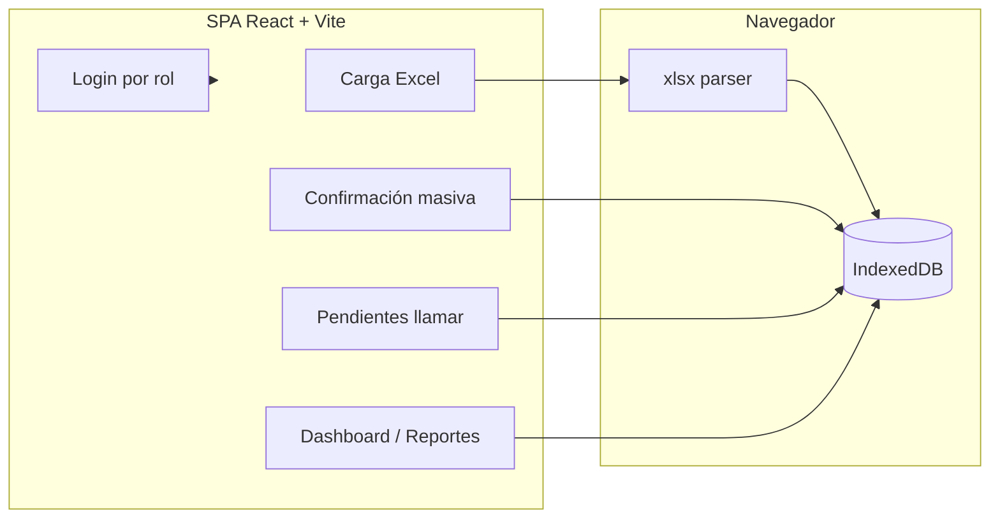

# Contactabilidad CESFAM · Demo Fluxor SpA

Proyecto conceptual de portafolio de **Fluxor SpA** (Adrián & José): una SPA que muestra cómo un CESFAM podría cargar citas, confirmar por WhatsApp (simulado), derivar pendientes a llamada y reportar resultados.

> **Datos ficticios · Proyecto conceptual · No es un sistema oficial del CESFAM.**  
> No uses ni subas exportaciones reales de AVIS ni datos de pacientes (Ley 19.628 / 20.584).

## Problema

Los centros de atención primaria gestionan muchas citas de control crónico con anticipación. Confirmar asistencia (WhatsApp + llamada) reduce inasistencias, pero hoy el flujo suele ser manual, fragmentado y difícil de auditar.

## Solución (esta demo)

1. **Cargar** una planilla Excel con columnas conocidas (plantilla incluida).
2. **Confirmar** de forma masiva (envío WhatsApp **simulado** → estado `enviado`).
3. **Simular respuestas** (`confirmado` / `cancelado` / `sin_respuesta`).
4. **Llamar** a quienes quedan en `sin_respuesta` (lista derivada automáticamente).
5. **Reportar** métricas calculadas desde los datos persistidos (sin cifras inventadas).

Todo corre **sin backend**: React + IndexedDB (`idb-keyval`) en el navegador.

## Arquitectura



| Capa | Tecnología |
|------|------------|
| UI | React 18, TypeScript, React Router, Recharts, Lucide |
| Persistencia | IndexedDB vía `idb-keyval` |
| Excel | `xlsx` (SheetJS) |
| Estilos | CSS variables Fluxor (navy `#0B1F3A`, azul `#1E5BB8`, teal `#00C2B8`, gris `#F4F6F8`) |
| Tipografías | Space Grotesk (títulos) + Inter (cuerpo) |
| Contenedor | Docker multi-stage + nginx (SPA fallback) |

### Roles (demo)

| Rol | Acceso |
|-----|--------|
| Funcionaria | Operación diaria (sin Reportes ni Configuración); filtra por su centro |
| Encargado | Operación + Reportes |
| Administrador | Todo + restablecer datos demo |

## Cómo ejecutar

### npm

```bash
npm install
npm run generate:plantilla   # regenera public/plantilla-citas-demo.xlsx
npm run dev                  # http://localhost:5173
npm run build
npm run preview
```

### Docker

```bash
docker compose up --build
# http://localhost:8080 (ver docker-compose.yml)
```

## Flujo de demo sugerido

1. Entra eligiendo un rol (p. ej. **Ada Admin**).
2. Ve el banner permanente de datos ficticios.
3. **Cargar Citas** → descarga `/plantilla-citas-demo.xlsx` → súbela (opcionalmente excluye morbilidad).
4. **Confirmación Masiva** → selecciona citas → *Enviar por WhatsApp (simulado)*.
5. Pulsa **Simular respuestas**.
6. **Pendientes por Llamar** → registra resultado de llamada.
7. **Dashboard / Reportes** → verifica que los números reflejan lo que hiciste.
8. **Configuración** (admin) → *Restablecer datos demo* si quieres empezar de nuevo.

## Privacidad

- Esta demo **solo** incluye pacientes inventados (`Demo …`, RUT `00.000.00X-X`, teléfonos `+56900000…`).
- `.gitignore` bloquea `*.xlsx` / `*.xls` / `*.csv` excepto `public/plantilla-citas-demo.xlsx`.
- **Nunca** commits de exportaciones AVIS ni datos reales de salud.
- No presentar este software como sistema oficial del CESFAM.

## Roadmap (fuera de esta demo)

- Cloudflare Pages en `demo.fluxor.cl` (tras revisión).
- Cloudflare Workers + D1 como API.
- WhatsApp Cloud API en sandbox (hoy el envío es `setTimeout` + cambio de estado).

## Capturas

Generadas con Playwright headless contra `vite`/`dist`:

| Paso | Archivo |
|------|---------|
| Login por rol | [`docs/screenshots/01-login.png`](docs/screenshots/01-login.png) |
| Dashboard | [`docs/screenshots/02-dashboard.png`](docs/screenshots/02-dashboard.png) |
| Confirmación masiva | [`docs/screenshots/03-confirmacion.png`](docs/screenshots/03-confirmacion.png) |
| Pendientes | [`docs/screenshots/04-pendientes.png`](docs/screenshots/04-pendientes.png) |
| Reportes | [`docs/screenshots/05-reportes.png`](docs/screenshots/05-reportes.png) |

GIF animado del flujo completo: **no generado** en este PR (placeholder). Se puede añadir luego como `docs/screenshots/flujo-demo.gif`.

## Deploy pendiente (Cloudflare Pages)

Aún **no** desplegado. Cuando Adrián apruebe:

| Setting | Valor |
|---------|-------|
| Build command | `npm run build` |
| Output directory | `dist` |
| SPA fallback | Sí (todas las rutas → `index.html`; ya está en `nginx.conf` para Docker) |
| Node version | 20.x recomendada |

## Créditos

Caso de portafolio · **Fluxor SpA** · Contactabilidad CESFAM (conceptual).
